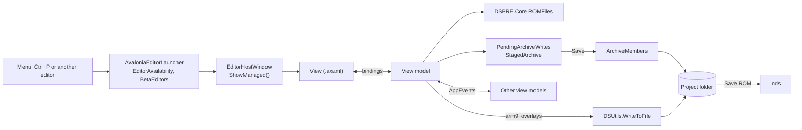

# DSPRE development guide

- [House style](#house-style)
- [Projects](#projects)
- [Build and run](#build-and-run) (publishing: [BUILDING.md](BUILDING.md))
- [Editors](#editors)
- [Agreed rules](#agreed-rules)
- [Code patches](#code-patches)
- [Beta editors](#beta-editors)
- [Tests](#tests)
- [ROM projects](#rom-projects)
- [Graphics](#graphics)
- [Scripts](#scripts)
- [Events](#events)
- [Known traps](#known-traps)
- [hg-engine projects](#hg-engine-projects)
- [Reference](#reference)

## House style

### Naming

Types, methods, properties and events are PascalCase. Private fields start with an underscore, like `_saved` or
`_undo`. Locals and parameters are camelCase, and so are constants declared inside a method.

DSPRE's own constants and `static readonly` fields are PascalCase, like `SafeMax`. A private `static readonly`
field behind a property or method of the same name keeps the underscore, like `_all` behind `All`. Constants that copy a name from
the decomp, a C header or OpenGL keep that name exactly, usually in UPPER_CASE, so one search finds them in both
places: `GL_TEXTURE_2D`, `WET02_START_Y_OFS`.

Methods that return a `Task` end in `Async`. A view is `<Thing>View` and its view model is `<Thing>ViewModel`. A
class split over several files uses `<Class>.<Part>.cs`, like `RomLocator.Tables.cs`.

Names use the game's words, or a player's, like `FriendshipChanges`. Enum members whose names are shown in
editors or written to exports, like `MoveFlags.MAGIC_COAT`, keep their spelling.

### Layout

Braces go on their own line, namespaces included, and indentation is four spaces. A file is named after its main
type, and small types that only serve it, like its enums, records and grid row classes, sit in the same file. A
family of small types with no main one, like the CSV import types, shares a file named after the topic. One-line members are written with `=>`.

### Reading and writing ROM data

A ROM file class is built from a byte array and turns itself back into bytes with `ToBytes()`. It checks the
length before reading. Fields DSPRE doesn't edit are kept, so opening a file and saving it without changes gives
back the same bytes.

```csharp
public sealed class FriendshipTable
{
    public const int Events = 10, Bands = 3, Size = Events * Bands;
    public sbyte[,] Values { get; } = new sbyte[Events, Bands];

    public FriendshipTable(byte[] data) { /* fill Values from data */ }
    public byte[] ToBytes() { /* the same layout back */ }

    public static string WhyNot() => RomLocator.WhyNot(RomLocator.Thing.FriendshipChanges, Size);
    public static FriendshipTable Load() => new FriendshipTable(RomLocator.Read(RomLocator.Thing.FriendshipChanges, Size));
    public void Save() => RomLocator.Write(RomLocator.Thing.FriendshipChanges, ToBytes());
}
```

Sizes and counts come from the ROM's own tables, counts and pointers.

Each format has one reader, and every editor uses it. A bug in reading a format is fixed in the reader, not in the
editors that show it.

Offsets and anything else that differs between games or languages live in `RomLocator` or `RomInfo`, as a switch
that names every game.

### Methods

Checks that end a method come first, each with its own `return`. The main work follows at the top indentation
level.

When something can be refused, a `WhyNot` method returns the reason as a string, or null when it's allowed.
Callers read it like this:

```csharp
if (ClassIntroPatch.WhyNotApplicable() is string why) { ShowError(why, "Patch not applied"); return false; }
```

A method that can fail in normal use is `bool TryX(..., out T result)` rather than one that throws.

### Errors

An error should never close DSPRE. When something fails, the user is told what didn't work, the details go to the
log, and the editor stays usable.

Code catches the exceptions it expects, such as a missing file, a file in use, or data too short to read, at the
point where it knows what was being attempted. That's what lets the message say "Trainer 12 wasn't saved" instead
of "Object reference not set".

Anything the user starts, like Save, Import, Open or Apply patch, also catches `Exception` around the whole
action. It logs the details with `CrashReporter.LogHandled`, shows `DialogHelper.ShowError`, and leaves the editor
open:

```csharp
private async void Save_Click(object sender, RoutedEventArgs e)
{
    try { await _vm.SaveChangesAsync(); }
    catch (Exception ex)
    {
        CrashReporter.LogHandled(ex);
        await DialogHelper.ShowErrorAsync("The trainer wasn't saved:\n" + ex.Message, "Save failed");
    }
}
```

`AvaloniaErrorHandler` catches anything that still reaches the UI thread and keeps DSPRE running, but it can only
say "An unexpected error occurred", so code shouldn't count on it.

Work started with `Task.Run` is awaited or catches its own errors. If it isn't, a failure is only logged and the
user never hears about it.

Code that has a fallback, like a name list that can come back empty or a preview that can draw nothing, may
catch everything, but logs it with `AppLogger.WarnOnce("Class.Method", ex)`. That logs the first failure at that
spot only, so a fallback that runs every frame doesn't flood the log.

An empty `catch { }` hides bugs. When an error really can be ignored, a comment says why.

### UX

An editor should be easy to follow for someone opening it for the first time, and still give power users
everything. Its main view holds what most people come to change. Settings few people touch are folded into an
Advanced section or a separate tool, and they stay complete there.

The user decides when their files change. Edits are a draft until Save, any of them can be undone or discarded,
and DSPRE asks before doing anything that would lose work. Warnings and guards cover what the user can't see
coming: losing unsaved work, a value that breaks in game, a patch that changes code, or a file that would be
written wrong. An edit whose result shows right away on screen applies without asking.

When an edit changes something the player sees, the editor shows it the way the game draws it, and the preview
follows every change, so a user can judge an edit without leaving DSPRE.

Editors are connected. A value that refers to another record leads to the editor for that record, any editor can
be opened by name, and when one editor changes data, the others showing it update. They also feel the same:
toolbars, saving, undo, notices and wording work alike everywhere, so knowing one editor means knowing the rest.

An editor shows what the open game has, under the names that game uses, and nothing it doesn't have.

### UI

Labels are short nouns, in the words players already use for the thing, never questions. A tooltip is a few words
and only says what the label can't, and a tour step is one sentence. Titles use sentence case. Buttons say what
they do, and one that takes you to another editor says "Open in <editor>". "…" appears only when the action asks
for more input.

Controls for something this game doesn't have are hidden. Controls that can't be used right now are disabled, with
a tooltip saying why.

Saving, exporting and importing confirm with a `SaveNotice` instead of a dialog. Messages don't use exclamation
marks, and Enter never answers a question. An editor that's slow to open shows the busy card while it loads.

Icons come from `Icon.Key`, not text symbols. Numbers are whole where the game's are.

### Comments and text

Comments explain why something is done, in a line, and only when the code doesn't already say it.

Code doesn't use `var`, and no text uses em dashes. The build rejects `var` and the calls listed in
`BannedSymbols.txt`.

Commit subjects follow `type(Scope): what changed`, without a body. Leaked source files are never named in the
repo; the pret decomps can be cited.

## Projects

| Project | Holds |
|---|---|
| `DSPRE.Core` | ROM formats, `ROMFiles`, `DSUtils`, `RomInfo`, scripts, text, hg-engine. No UI. |
| `DSPRE.Avalonia` | The app: views, view models, the GL renderer, readers only the UI uses. |
| `DSPRE.Tests` | xunit tests. |

All target net8.0. Classes that write back to the ROM live in `DSPRE.Core/ROMFiles`. Read-only types used for
drawing or listing live in `DSPRE.Avalonia/Avalonia/Data`. Core shows messages through `AppMessages`; a finished
save or export there calls `AppMessages.Notice`, which shows as a `SaveNotice`.

### Folders

Views and view models share eleven folders, one namespace each, named after the menu:

```
Shell  Pokemon  Trainers  Items  Text  World  Graphics  Battle  Audio  Tools  Controls
```

`Controls` holds shared controls with no menu entry. C# gets each folder through a global using; XAML names it
with `xmlns:vm`.

## Build and run

```powershell
dotnet build DSPRE.sln
dotnet test DSPRE.Tests/DSPRE.Tests.csproj
```

Visual Studio has launch profiles for Windows and WSL, each with a `--beta` variant. Close `DSPRE.Avalonia.exe`
and `rotom-lsp.exe` before building. When a XAML change fails with no clear error, this shows it:

```powershell
dotnet build DSPRE.sln -v m --nologo 2>&1 | Select-String ": error |AVLN"
```

## Editors

The easiest start is copying an editor from the same folder. `CameraEditorViewModel` is a small one,
`MapEditorViewModel` a large one.

### How an editor fits together

Editors are MVVM: the view binds to its view model, and the view model holds the state and reads and writes ROM
types from `DSPRE.Core`.



`ShowManaged` tracks the window for the unsaved-changes check (`OpenEditors`) and calls `IDetachable.Detach` when
it closes.

### View model

Each view model implements `INotifyPropertyChanged` itself, with no ReactiveUI, CommunityToolkit or base class. The
parameterless constructor is for the XAML designer and returns straight away outside it, since there is no ROM to
read there. Grid rows get a small `...Row` or `...VM` class in the same file, which keeps the fields the UI doesn't
show.

```csharp
public class MyEditorViewModel : INotifyPropertyChanged
{
    public event PropertyChangedEventHandler PropertyChanged;
    private void Raise([CallerMemberName] string n = null) => PropertyChanged?.Invoke(this, new PropertyChangedEventArgs(n));

    public MyEditorViewModel() { if (!Design.IsDesignMode) return; }
    public MyEditorViewModel(string[] names) { ... }

    private int _index;
    public int Index { get => _index; set { if (_index == value) return; _index = value; Raise(); } }
}
```

### Unsaved changes

An editor that changes data implements `IEditorWithUnsavedChanges`; that is how closing the ROM knows to ask about
it. It compares the current bytes with the saved ones, returns false from `SaveChangesAsync` when the save fails,
ends a save with `SaveNotice.Saved(...)`, and asks through `RecordSwitchGuard.ConfirmLeaveAsync` before leaving an
edited record. From `FriendshipChangesViewModel`:

```csharp
public bool HasUnsavedChanges => _table != null && !_table.ToBytes().AsSpan().SequenceEqual(_saved);
public string UnsavedChangesDescription => "Friendship changes";

public void SaveChanges() => _ = SaveChangesAsync();

public async Task<bool> SaveChangesAsync()
{
    if (_table == null) return true;
    try { _table.Save(); }
    catch (Exception e) when (e is IOException || e is UnauthorizedAccessException || e is InvalidOperationException)
    {
        await DialogHelper.ShowErrorAsync("The friendship changes were not saved:\n" + e.Message, "Friendship changes error");
        return false;
    }
    _saved = _table.ToBytes();
    Changed();
    SaveNotice.Saved(UnsavedChangesDescription);
    return true;
}

public void DiscardChanges() { CopyValues(_saved); StartUndo(); Changed(); }
```

### Undo

Undo comes from `ByteStateUndo`, or `UndoHistory<T>` for state that isn't bytes. The view model implements
`ISupportsUndo` and the view adds `<controls:UndoRedoButtons/>`. Changes recorded with the same group
(`ByteStateUndo.Record(group)`, `PendingArchiveWrites.Change(make, group)`) undo as one step; the colour popup
passes itself as the group.

```csharp
private ByteStateUndo _undo;
private void StartUndo() => _undo = new ByteStateUndo(() => _table.ToBytes(), b => { CopyValues(b); Changed(); },
    () => { Raise(nameof(CanUndo)); Raise(nameof(CanRedo)); });
public bool CanUndo => _undo?.CanUndo == true;
public bool CanRedo => _undo?.CanRedo == true;
public void Undo() => _undo?.Undo();
public void Redo() => _undo?.Redo();

private void Changed() { Raise(nameof(HasUnsavedChanges)); _undo?.Record(); }   // after every edit
```

### View

A view lives in `Views/<Folder>/MyEditorView.axaml`, with `x:Class` in that folder's namespace and `x:DataType`
set. Without `x:DataType` the build fails with an error that points somewhere else. Views are `UserControl`s so
they can also sit in the Maps workspace, and their code-behind holds event handlers only.

```xml
<UserControl xmlns="https://github.com/avaloniaui"
             xmlns:controls="clr-namespace:DSPRE.Avalonia.Controls"
             xmlns:x="http://schemas.microsoft.com/winfx/2006/xaml"
             xmlns:vm="clr-namespace:DSPRE.Avalonia.ViewModels.Pokemon"
             x:Class="DSPRE.Avalonia.Views.Pokemon.FriendshipChangesView"
             x:DataType="vm:FriendshipChangesViewModel">
  <Design.DataContext>
    <vm:FriendshipChangesViewModel/>
  </Design.DataContext>
```

### Maps workspace

The main window is `MapsWorkspaceView`: the header list on the left, and tabs that hold the editors' own views for
the selected header (Header, Map, Events, Matrix, Area Data, Encounters, Scripts, Level Scripts, Text). An editor
added as a tab is listed in `MapsWorkspaceView.GetEmbeddedEditors`, so its unsaved changes are checked.

### Opening it

Each editor has an open method in `AvaloniaEditorLauncher.cs` and a rule in `EditorAvailability.cs`:

```csharp
public static void OpenMyEditor()
{
    if (Refused(nameof(MyEditorView))) return;
    new EditorHostWindow("My editor", new MyEditorView(new MyEditorViewModel(names)), 900, 600).ShowManaged();
}
```

Windows open with `ShowManaged()`, which places them, registers them with `OpenEditors` and asks the beta gate; a
plain `Show()` skips all three. One-table editors use `OpenTableEditor(...)`. A `Window` editor calls
`EditorWindowChrome.Attach(window, vm)`. An editor that only ever has one window uses
`BringForward<TView, TModel>(goTo)`. A slow first open goes through `OpenBehindCardAsync`, with only the file work
off the UI thread.

```csharp
public static void OpenFriendshipChanges() => OpenTableEditor("Friendship Changes", FriendshipTable.WhyNot,
    () => new FriendshipChangesView(new FriendshipChangesViewModel(true)), 760, 480, 640, 440);

await OpenBehindCardAsync("Opening Audio Editor…", "Reading the cries, music and sound effects.",
    () => DSUtils.TryUnpackNarcs(new List<DirNames> { DirNames.PersonalPokeData }),   // off the UI thread
    () => new AudioEditorView(new AudioEditorViewModel(names)));                        // on it, card still up
```

### Menu

In `MainWindowView.axaml` the menu item binds `IsVisible` to `Shown[MyEditorView]`, `IsEnabled` to
`Usable[MyEditorView]` and `ToolTip.Tip` to `BlockedNote[MyEditorView]`. The editor also gets a command in
`AvaloniaEditorLauncher.BuildCommands`, for Ctrl+P, and a tour in `EditorTours.<Folder>.cs`.

### Shared helpers

| For | Use |
|---|---|
| Dialogs | `DialogHelper` |
| Good, warning, bad colours | `StatusBrushes`; `Editor.Good`, `Editor.Warn`, `Editor.Bad` in XAML |
| Telling other editors | `AppEvents` |
| Renamable names | `LabelStore` |
| Pixels to a bitmap | `ImageConverter.FromRgba` |
| Name lists | `NameRefresh.Bind`, `ListSync.Apply`, `FilteredNames` |
| One overworld sprite | `OverworldSpriteView`; `OverworldSprites.Get` and `Outlined` |
| Message and menu borders | `WindowFrames` |
| DSPRE's own folders, logging | `AppPaths`, `AppLogger` (Core) |
| Pixels in Core | `RawImage` |
| Counts in text ("1 map", "3 maps") | `Plural.Of` (Core) |

An editor that only draws archive members redraws with `AppEvents.WhenSaved(redraw, dirs)`.

### Asking the user

Dialogs go through `DialogHelper` with the editor as owner, and Discard asks through
`DialogHelper.ConfirmDiscardAsync(this)`. A choice that needs a preview is a small class with `AskAsync`, like
`PngColourPrompt`.

### Toolbar and controls

`EditorToolbar` keeps the controls in the same order in every editor: the first row holds the picker, Save,
Discard, Undo and Redo. The second holds Add, Remove, Import, Export and the editor's own buttons. A control's place comes
from its label, or from `controls:EditorToolbar.Slot` when the label doesn't say.

```xml
<controls:EditorToolbar>
  <Button Content="Save" controls:Icon.Key="saveButton" Click="Save_Click"/>
  <controls:UndoRedoButtons/>
  <Button Content="Copy" Click="Copy_Click" controls:EditorToolbar.Slot="Extra"/>
</controls:EditorToolbar>
```

Name pickers are `FusionAutoCompleteBox`, number-and-name pickers `IdNameSelector`. `controls:EditorLink.To` links a
value to its editor, and `HelpTip` adds a one-line hint.

### Tours

Each editor has one `Add("XView", "Name", S(target, title, body), ...)` in `EditorTours.<Folder>.cs`. A target is
null, `"toolbar"`, `"tabs"`, `"list"`, `"name:X"`, `"type:X"` or `"tab:Name"`, optionally prefixed with
`"pick:List>"`.

```csharp
Add("CameraEditorView", "Camera Editor",
    S("list", "Camera angles", "Each row is a camera a header can use. Headers pick one by its number."),
    S("list", "Changing a camera", "Double-click a cell to change its distance, rotation, field of view or clipping."));
```

## Agreed rules

New code follows these, and older code is being moved over.

### Writing game files

Archive members are written through `ArchiveMembers.Put` and `ArchiveMembers.Delete`, or `Write(path, bytes)` when
only the path is known. arm9 and overlays are written through `DSUtils.WriteToFile` or `DSUtils.WriteWholeFile`,
which check the hg-engine write guard. Everything else, such as exports, DSPRE's own data, project sources,
backups and temp files, goes through `PlainFiles`, which refuses members and code. Source text in an hg-engine
checkout goes through `HgEngineVerifiedWrite`.

```csharp
ArchiveMembers.Put(DirNames.PersonalPokeData, species, bytes);
DSUtils.WriteToFile(OverlayUtils.GetPath(overlay), patch, writeAt: (uint)offset);
PlainFiles.WriteBytes(exportPath, bytes);
```

### Unsaved archive edits

Editors keep archive changes in `PendingArchiveWrites` until Save. Editors that work on one member at a time use
`StagedArchive`. An editor with its own undo stores `PendingArchiveWrites.Take()` in each state. Scripts, trainers,
new map headers and new overworld entries still apply straight away, after asking.

```csharp
_pending.Change(step => step.Put(DirNames.DungeonCutinGraphics, p, nclrBytes)
                            .Put(DirNames.DungeonCutinGraphics, t, ncgrBytes));   // one undo step
byte[] shown = _pending.Read(DirNames.DungeonCutinGraphics, p);                    // sees unsaved changes
_pending.Save();                                                                   // or Discard()
```

### Touch buttons and cursors

A screen's touch areas and arrow-key tables are read in Core behind `IScreenButtons`, and `ScreenCatalog.ButtonTabs` turns a
reader into the Layout and Cursor tabs in the Screens editor. Each reader gathers its tables into a `ScreenTables`, which writes
every file back whole and reports only problems the files didn't already have. Table offsets live in RomLocator: the located
anchors per game and language, and the distances from them in `RomLocator.ScreenTables.cs`. `TouchRects` moves and sizes the
games' touch rectangles; a touch on the right or bottom edge misses.

`GridMenuButtons` reads screens on the shared grid input handler, and `HgssMenuButtons` builds the PC and Pokédex pages on it.
`TouchListButtons` reads touch lists with no cursor table, and `PlatinumTouchLists` and `HgssTouchLists` build on it with
`ButtonNames`. The battle, bag, touch menu, Pokégear, summary and party menu screens each have a separate reader. Picture spots that
move with a button are `TouchListButtons.Spots` entries. Background art that moves is a page's `ScreenTiles`, which
`ScreenTileArt` reads and writes. Spots the code loads with Thumb instructions are `GridMenuButtons.CodeSpot`s. A button whose
art the game places itself is locked with `TouchRects.FixedArt`.

The picture function runs on the UI thread and reads what the page needs; the function it returns draws off the UI thread.

```csharp
ButtonTabs(PlatinumTouchLists.Bag, "Bag", (bag, page) =>
{
    IReadOnlyList<(int X, int Y)> spots = bag.SpotsOf(page);   // read now
    return () => GameTextScreens.BagBottomPt(spots);            // drawn off the UI thread
}, cursor: false);
```

### Events

View models subscribe to events themselves and implement `IDetachable`, and `ShowManaged` detaches them when the
window closes. Views listen only to their own view model.

```csharp
public class BattleScreenEditorViewModel : INotifyPropertyChanged, IDetachable
{
    public BattleScreenEditorViewModel() { ... AppEvents.RomPatchStateChanged += OnPatchStateChanged; }
    public void Detach() => AppEvents.RomPatchStateChanged -= OnPatchStateChanged;
}
```

### Where things are in the ROM

Code offsets live in `RomLocator`, as a switch on game then language with every case written out. Single offsets
are `RomLocator.Thing` values read through `Where`, `Read`, `Write`, `WhyNot` and `WorksOn`. Groups of sites are
records in `RomLocator.Sites.cs`, and per-dump values are in `RomLocator.Offsets.cs`, `.Tables.cs`,
`.FixedTables.cs` and `.Measured.cs`. Text bank numbers and offsets inside script files stay in `RomInfo`.
`RomLocator.WorksOn` and `RomInfo.DescribeDumps` say which dumps a feature works on.

```csharp
// RomLocator.Tables.cs; the Thing is added to the enum and the map in RomLocator.cs
private static Spot? FriendshipChanges(GameVersions game, GameLanguages language, int revision) => game switch
{
    GameVersions.Platinum => language switch
    {
        GameLanguages.English when revision == 10 => Arm9(0xF05A0),   // Europe
        ...
        _ => null,
    },
    ...
};

byte[] bytes = RomLocator.Read(RomLocator.Thing.FriendshipChanges, Size);
```

### Graphics

Each format has one reader that works from bytes, members are read through `ScriptNarc`, and bitmaps are made by
`ImageConverter` and shown without smoothing.

## Code patches

`ApplyClassIntrosPatch` and `ROMFiles/ClassIntroPatch.cs` are the model to copy. A synthetic-overlay patch has:

- a `ROMFiles` class with a 12-byte `Marker` (listed in `SyntheticOverlaySpace.BlockMarkers`), `IsApplied`,
  `WhyNotApplicable()`, `Apply(int blockOffset)`, and its `.s` source under `Resources/ROMToolboxDB/`;
- in `PatchToolboxLogic`: an `Apply...Patch()`, a `Status` entry, its key in `ApplyByKey` and in the hg-engine
  refusal list, and a `Credits` entry;
- a `PatchNotes` entry and the key's tab in `PatchToolboxViewModel`.

```csharp
public static bool ApplyClassIntrosPatch()
{
    if (AlreadyApplied(Probe(() => ClassIntroPatch.IsApplied))) return false;
    if (ClassIntroPatch.WhyNotApplicable() is string why) { ShowError(why, "Patch not applied"); return false; }
    if (PlacementNote(new[] { ClassIntroPatch.BlockLength }, out int[] offsets) is not string placement) return false;
    if (!ConfirmYesNo("What the patch does." + placement + BackupNote("the ARM9 and the synthetic overlay") +
        "\n\nApply this patch?" + CreditNote("classIntros"), "Confirm to proceed"))
        return false;
    PlainFiles.Copy(Filesystem.ExpArmPath, Filesystem.ExpArmPath + BackupSuffix, overwrite: true);
    ClassIntroPatch.Apply(offsets[0]);
    ShowInfo("What changed and where to edit it.", "Patch applied");
    return true;
}
```

Each patch applies only itself. One that needs the ARM9 expansion returns `Unsupported("Requires ARM9
expansion")`. Editors hand patches over to the Patch Toolbox with an "Open in Patch Toolbox" button
(`AvaloniaEditorLauncher.OpenPatchToolboxAt(key)`) and refresh on `AppEvents.RomPatchStateChanged`.

### Synthetic overlay space

Each block starts with a 32-byte header: marker, version, length. `Reserved`, `Plan`, `PlaceAt` and `Place` in
`SyntheticOverlaySpace` find room. A table that grows has one class with `MoveToExpansion()`, like
`SwarmTable.MoveToExpansion`.

## Beta editors

Beta editors are listed by window class in `DSPRE.Core/BetaEditors.cs`. They're off unless the app starts with
`--beta`, and always on in Debug builds. The UI doesn't mention the switch.

## Tests

```powershell
dotnet test DSPRE.Tests/DSPRE.Tests.csproj --filter "FullyQualifiedName~BattleIcon"
```

Test projects are set per machine in `testroms.json` next to `DSPRE.sln` (ignored by git), or with
`DSPRE_TEST_HEARTGOLD`, `DSPRE_TEST_PLATINUM` and `DSPRE_TEST_DIAMOND`:

```json
{ "heartGold": "<path>", "platinum": "<path>", "diamond": "<path>" }
```

Tests read them through `TestRoms`. A test that opens a ROM has `[Collection("rom")]`, and only one test process
runs at a time, since they share the ROM fixtures.

## ROM projects

ds-rom projects (`config.yaml`, `files/`, `arm9/`, `arm9_overlays/`) and legacy ndstool projects (`header.bin`,
`data/`, `overlay/`) both work. Detection is in `DSUtils.GetFolderType`, and overlay paths come from
`OverlayUtils.GetPath`. ds-rom handles overlay compression, so overlays are read and written as they are in the
project. RAM addresses become file offsets with `RamAddress.Find`.

### Archives

Each archive is a `RomInfo.DirNames` value mapped in `RomInfo.GameDirs`. `DSUtils.TryUnpackNarcs` unpacks it
before the first read, and from then on DSPRE reads and writes the unpacked folder.

### Save ROM

Save ROM compiles changed Rotom scripts, settles archives changed outside DSPRE (`NarcSync`), rebuilds text and
script binaries, packs every archive except hg-engine's own, and builds the `.nds` with ds-rom. Any failure stops
it before anything is written.

### Rotom

Rotom owns the project's command database in `.rotom/command_database/`. DSPRE reads it through
`RotomTool.ProjectDatabaseFile()` and leaves changing it, and regenerating script sources, to Rotom.

## Graphics

`GraphicAssets.All` lists every 2D archive, with its colour pairing and grouping; `ModelAssets.All` does the same
for 3D. Readers, all in `DSPRE.Core/ROMFiles`:

| Format | Reader |
|---|---|
| Colours (NCLR) | `NitroBgCodec.ReadColours`, `ReadPalette`, `PutColour` |
| Drawings (NCGR) | `NitroBgCodec.ReadCharacters`, `DrawingFile` |
| Screens (NSCR) | `NitroBgCodec.ReadMap`, `Composite` |
| Cells (NCER) | `NcerFile.Read`, `CellRenderer.Draw` |
| Cell animations (NANR) | `NanrFile.Read` |
| Textures (TEX0) | `Tex0Block`, `NsbmdTextureDecoder` |
| LZ77 | `Lz77.Decompress`, `Compress` |

A game screen is drawn by a renderer that returns its pieces with their source files (`BattleScreenRenderer`,
`ScreenPageComposer`). Pokédex and summary pages are `ScreenBook`s (`PokedexBook`, `SummaryBook`) shown by
`ScreenPagesView`. PNG export keeps colour numbers, and shared-palette imports refuse a PNG with the wrong colours
and offer `PngColourPrompt`. `OpenGraphicAt` and `OpenPainter` hand a graphic to the Graphics window or the
painter, with the colours file and row the screen shows it in. Changing a file other pieces also show asks first
("This piece is shared"), in the Battle screen editor and in `ScreenPagesView` alike. Battle text goes into the
message box through `BattleMessageText`.

Move animation code lives in `Avalonia/BattleAnim/`. `SplManager` is the game's particle library, in fixed point.
`BattleParticles` places and moves its emitters the way a battle does, and `SplRenderer` draws them the way the DS
does. All three are in `Particles/`. Each sprite function that `AddSpriteWithFunc` can call has a file in
`SpriteEffects/`, listed by number in `SpriteEffectTable`. An effect sees the battle only through
`IBattleAnimSystem` and builds its moves from `BattleAnimHelpers`.
Particles shown outside a move go through `SplScene`: the Particle editor, send-out ball bursts and seals, and the
League VS intro.

## Scripts

`DSPRE.Core/ROMFiles/ScriptFile.cs` owns binary scripts and the text under `expanded/scripts/`: timestamps,
caching, the database hash and rebuilds. Everything that reads or writes scripts goes through it.

Script numbers from 2000 up are shared scripts. `CommonScriptId.Resolve` gives the range, script file and script
number, and `CommonScriptLabels` holds the names users give them.

## Events

Overworld sprites 101 to 116 are picked by a script while playing, from variable 0x4020 up. The editor draws
`RomInfo.VariableOverworldStandIn` with an outline for them (`RomInfo.IsVariableOverworld`).

## Known traps

- Layouts differ between games and languages, so `RomInfo.GameFamily` and `GameLanguage` decide every offset.
- `param0` is stored as `SightRange` but is the engine's general parameter.
- Tile sheets often store `0xFFFF` for width and height. That reads as -1, and the cell layout decides the shape.
- Backgrounds wider than 32 squares are stored in 32x32 blocks.
- Battle sprite palettes are per species, and their pixels are XOR-scrambled.
- A hidden `TabItem` still counts as tab zero. A `ComboBox` loses `SelectedIndex` when its items change.
- Editing an `ObservableCollection` inside its own `CollectionChanged` throws.

## hg-engine projects

An hg-engine ROM has "hg-engine rocks!" at the start of overlay 129 (`RomInfo.IsHGE`).
`HgEngineProject.IsActive` means a checkout is linked. Each `EditorAvailability` rule says `Open`, `NeedsLink`,
`Source`, `Closed` or `LinkedOnly`. With a checkout linked, data is read from its source text rather than by
offset, and written through `HgEngineVerifiedWrite`. Synthetic-overlay patches are refused.

## Reference

`Research/` holds documented game knowledge, maintained by human contributors. Bundled tools are in `Tools/` and
are copied next to the exe.
