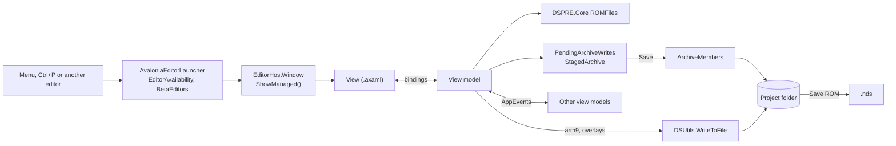

# DSPRE development guide

Build and publish: [BUILDING.md](BUILDING.md).

## Projects

| Project | Holds |
|---|---|
| `DSPRE.Core` | ROM formats, `ROMFiles`, `DSUtils`, `RomInfo`, scripts, text, hg-engine. No UI. |
| `DSPRE.Avalonia` | The app: views, view models, the GL renderer, readers only the UI uses. |
| `DSPRE.Tests` | xunit tests. |

All target net8.0. Anything written back to the ROM goes in `DSPRE.Core/ROMFiles`: it reads from a `byte[]`,
checks the length, and writes back with `ToBytes()`. Unknown fields and padding are written back as
they were. Read-only types for drawing
or listing go in `DSPRE.Avalonia/Avalonia/Data`. Core shows messages only through `AppMessages`.

### Folders

Views and view models share eleven folders, one namespace each, named after the menu:

```
Shell  Pokemon  Trainers  Items  Text  World  Graphics  Battle  Audio  Tools  Controls
```

`Controls` holds shared controls with no menu entry. C# gets each folder through a global using; XAML names it
with `xmlns:vm`.

## Build and run

```powershell
dotnet build DSPRE.sln
dotnet test DSPRE.Tests/DSPRE.Tests.csproj
```

Visual Studio has launch profiles for Windows and WSL, each with a `--beta` variant. Close `DSPRE.Avalonia.exe`
and `rotom-lsp.exe` before building. If a XAML change fails with no clear error:

```powershell
dotnet build DSPRE.sln -v m --nologo 2>&1 | Select-String ": error |AVLN"
```

## Editors

Copy an editor from the same folder. `CameraEditorViewModel` is small, `MapEditorViewModel` large.

### How an editor fits together

Editors are MVVM: the view binds to its view model, the view model holds the state and reads and writes ROM
types from `DSPRE.Core`.



`ShowManaged` tracks the window for the unsaved-changes check (`OpenEditors`) and calls `IDetachable.Detach`
on close.

### View model

Plain `INotifyPropertyChanged` in each class; no ReactiveUI, CommunityToolkit or base class. A parameterless
constructor starts with `if (!Design.IsDesignMode) return;`, or the designer reads `RomInfo` with no ROM. Grid
rows get a small `...Row` or `...VM` class in the same file and keep fields the UI doesn't show.

### Unsaved changes

Every editor that changes data implements `IEditorWithUnsavedChanges`, or its changes are lost when the ROM
closes. Compare current bytes with the saved bytes, return false from `SaveChangesAsync` on failure, end a save
with `SaveNotice.Saved(...)`, and ask through `RecordSwitchGuard.ConfirmLeaveAsync` before leaving an edited
record. `FriendshipChangesViewModel` is the example.

### Undo

Use `ByteStateUndo`, or `UndoHistory<T>` for state that isn't bytes; implement `ISupportsUndo` and add
`<controls:UndoRedoButtons/>`. No private undo stacks. Changes passed the same group
(`ByteStateUndo.Record(group)`, `PendingArchiveWrites.Change(make, group)`) are one step; the colour popup
passes itself.

### View

`Views/<Folder>/MyEditorView.axaml`, with `x:Class` in that folder's namespace and `x:DataType` set. Make it a
`UserControl` so it can sit in the Maps workspace. Code-behind holds event handlers only.

### Maps workspace

The main window is `MapsWorkspaceView`: the header list on the left, and tabs that hold the editors' own views
for the selected header (Header, Map, Events, Matrix, Area Data, Encounters, Scripts, Level Scripts, Text). An
editor added as a tab goes in `MapsWorkspaceView.GetEmbeddedEditors`, so its unsaved changes are checked.

### Opening it

Add a method to `AvaloniaEditorLauncher.cs`:

```csharp
public static void OpenMyEditor()
{
    if (Refused(nameof(MyEditorView))) return;
    new EditorHostWindow("My editor", new MyEditorView(new MyEditorViewModel(names)), 900, 600).ShowManaged();
}
```

Add its rule to `EditorAvailability.cs`. Always `ShowManaged()`, never `Show()`. One-table editors use
`OpenTableEditor(...)`. A `Window` editor calls `EditorWindowChrome.Attach(window, vm)`. An editor with one
window uses `BringForward<TView, TModel>(goTo)`. Slow first opens go through `OpenBehindCardAsync`, with only
file work off the UI thread.

### Menu

In `MainWindowView.axaml` bind `IsVisible` to `Shown[MyEditorView]`, `IsEnabled` to `Usable[MyEditorView]` and
`ToolTip.Tip` to `BlockedNote[MyEditorView]`. Add a command in `AvaloniaEditorLauncher.BuildCommands` and a tour
in `EditorTours.<Folder>.cs`.

### Shared helpers

| For | Use |
|---|---|
| Dialogs | `DialogHelper` |
| Good, warning, bad colours | `StatusBrushes`; `Editor.Good`, `Editor.Warn`, `Editor.Bad` in XAML |
| Telling other editors | `AppEvents` |
| Renamable names | `LabelStore` |
| Pixels to a bitmap | `ImageConverter.FromRgba` |
| Name lists | `NameRefresh.Bind`, `ListSync.Apply`, `FilteredNames` |
| One overworld sprite | `OverworldSpriteView`; `OverworldSprites.Get` and `Outlined` |
| Message and menu borders | `WindowFrames` |
| DSPRE's own folders, logging | `AppPaths`, `AppLogger` (Core) |
| Pixels in Core | `RawImage` |

Subscribe to `AppEvents` in the view model and implement `IDetachable`. An editor that only draws archive
members uses `AppEvents.WhenSaved(redraw, dirs)`.

### Asking the user

Every dialog goes through `DialogHelper` with the editor as owner. Every Discard asks
`DialogHelper.ConfirmDiscard(this)`. A choice that needs a preview is a small class with `AskAsync`
(`PngColourPrompt`). Hide what this game doesn't have; disable what can't work now, with a tooltip saying why.

### Toolbar and controls

`EditorToolbar` orders controls the same everywhere. Name pickers are `FusionAutoCompleteBox`, number and name
pickers `IdNameSelector`. `controls:EditorLink.To` links a value to its editor. `HelpTip` adds a one-line hint.
Icons come from `Icon.Key`, never text symbols.

### Tours

One `Add("XView", "Name", S(target, title, body), ...)` per editor in `EditorTours.<Folder>.cs`. Targets: null,
`"toolbar"`, `"tabs"`, `"list"`, `"name:X"`, `"type:X"`, `"tab:Name"`, optionally prefixed `"pick:List>"`.

## Agreed rules

New code follows these; older code is being moved over.

### Writing game files

Archive members are written only through `ArchiveMembers.Put` and `ArchiveMembers.Delete` (or `Write(path,
bytes)` when you only have a path). arm9 and overlays are written only through `DSUtils.WriteToFile` or
`DSUtils.WriteWholeFile`, which ask the hg-engine write guard. Everything else (exports, DSPRE's own data,
project sources, backups, temp files) goes through `PlainFiles`, which refuses members and code. hg-engine
checkout source text goes through `HgEngineVerifiedWrite`.

### Unsaved archive edits

Editors keep archive changes in `PendingArchiveWrites` until Save. One-member-at-a-time editors use
`StagedArchive`. An editor with its own undo stores `PendingArchiveWrites.Take()` in each state. Scripts,
trainers, new map headers and new overworld entries still apply straight away, after asking.

### Events

View models subscribe to events themselves and implement `IDetachable`; `ShowManaged` detaches them on close.
Views listen only to their own view model.

### Where things are in the ROM

Code offsets live in `RomLocator`, as a switch on game then language with every case written out. Single
offsets are `RomLocator.Thing` values read through `Where`, `Read`, `Write`, `WhyNot` and `WorksOn`; groups of
sites are records in `RomLocator.Sites.cs`; per-dump values are in `RomLocator.Offsets.cs`, `.Tables.cs`,
`.FixedTables.cs` and `.Measured.cs`. Text bank numbers and offsets inside script files stay in
`RomInfo`. `RomLocator.WorksOn` and `RomInfo.DescribeDumps` say which dumps a feature works on.

### Graphics

One reader per format, from bytes, through `ScriptNarc`, to bitmaps through `ImageConverter`, shown without
smoothing.

### Wording

Sentence-case titles. Buttons name the action; handovers say "Open in <editor>". Saves, exports and imports
use `SaveNotice`, not dialogs. No exclamation marks, and Enter never confirms a question.

## Code patches

Start from `ApplyClassIntrosPatch` and `ROMFiles/ClassIntroPatch.cs`. A synthetic-overlay patch needs:

- a `ROMFiles` class with a 12-byte `Marker` (listed in `SyntheticOverlaySpace.BlockMarkers`), `IsApplied`,
  `WhyNotApplicable()`, `Apply(int blockOffset)`, and its `.s` source under `Resources/ROMToolboxDB/`;
- in `PatchToolboxLogic`: an `Apply...Patch()`, a `Status` entry, its key in `ApplyByKey` and in the hg-engine
  refusal list, and a `Credits` entry;
- a `PatchNotes` entry and the key's tab in `PatchToolboxViewModel`.

A patch never applies another patch; one that needs the ARM9 expansion returns `Unsupported("Requires ARM9
expansion")`. Editors never apply patches: they show "Open in Patch Toolbox"
(`AvaloniaEditorLauncher.OpenPatchToolboxAt(key)`) and refresh on `AppEvents.RomPatchStateChanged`.

### Synthetic overlay space

Each block starts with a 32-byte header: marker, version, length. `Reserved`, `Plan`, `PlaceAt` and `Place` in
`SyntheticOverlaySpace` find room. A growing table has one class with `MoveToExpansion()`;
`SwarmTable.MoveToExpansion` is the example.

## Beta editors

Listed by window class in `DSPRE.Core/BetaEditors.cs`. Off unless the app starts with `--beta`; always on in
Debug. The UI never mentions the switch.

## Tests

```powershell
dotnet test DSPRE.Tests/DSPRE.Tests.csproj --filter "FullyQualifiedName~BattleIcon"
```

Test projects are set per machine in `testroms.json` next to `DSPRE.sln` (ignored by git), or with
`DSPRE_TEST_HEARTGOLD`, `DSPRE_TEST_PLATINUM` and `DSPRE_TEST_DIAMOND`:

```json
{ "heartGold": "<path>", "platinum": "<path>", "diamond": "<path>" }
```

Read them through `TestRoms`. Put `[Collection("rom")]` on any test that opens a ROM, and don't run two test
processes at once.

## ROM projects

ds-rom projects (`config.yaml`, `files/`, `arm9/`, `arm9_overlays/`) and legacy ndstool projects
(`header.bin`, `data/`, `overlay/`) both work. Detection is in `DSUtils.GetFolderType`; overlay paths come from
`OverlayUtils.GetPath`. Never decompress an overlay yourself. RAM addresses become file offsets with
`RamAddress.Find`.

### Archives

Each archive is a `RomInfo.DirNames` value mapped in `RomInfo.gameDirs`. Call `DSUtils.TryUnpackNarcs` before
the first read, then read and write only the unpacked folder.

### Save ROM

Save ROM compiles changed Rotom scripts, settles archives changed outside DSPRE (`NarcSync`), rebuilds text and
script binaries, packs every archive except hg-engine's own, and builds the `.nds` with ds-rom. Any failure stops
it before anything is written.

### Rotom

Rotom owns `.rotom/command_database/`. DSPRE never replaces it or regenerates script sources wholesale.
`RotomTool.ProjectDatabaseFile()` is that database.

## Graphics

`GraphicAssets.All` lists every 2D archive, with its colour pairing and grouping; `ModelAssets.All` does the
same for 3D. Readers, all in `DSPRE.Core/ROMFiles`:

| Format | Reader |
|---|---|
| Colours (NCLR) | `NitroBgCodec.ReadColours`, `ReadPalette`, `PutColour` |
| Drawings (NCGR) | `NitroBgCodec.ReadCharacters`, `DrawingFile` |
| Screens (NSCR) | `NitroBgCodec.ReadMap`, `Composite` |
| Cells (NCER) | `NcerFile.Read`, `CellRenderer.Draw` |
| Cell animations (NANR) | `NanrFile.Read` |
| Textures (TEX0) | `Tex0Block`, `NsbmdTextureDecoder` |
| LZ77 | `Lz77.Decompress`, `Compress` |

A game screen is drawn by a renderer that returns pieces with their source files (`BattleScreenRenderer`,
`ScreenPageComposer`). Pokédex and summary pages are `ScreenBook`s (`PokedexBook`, `SummaryBook`) shown by
`ScreenPagesView`. PNG export keeps
colour numbers; shared-palette imports refuse a wrong PNG and offer `PngColourPrompt`. `OpenGraphicAt` and
`OpenPainter` hand a graphic to the Graphics window or painter.

## Scripts

`DSPRE.Core/ROMFiles/ScriptFile.cs` owns binary scripts and the text under `expanded/scripts/`: timestamps,
caching, the database hash and rebuilds. Don't add another script reader.

Script numbers from 2000 up are shared scripts. `CommonScriptId.Resolve` gives the range, script file and script
number; `CommonScriptLabels` holds the names users give them.

## Events

Overworld sprites 101 to 116 are picked by a script while playing, from variable 0x4020 up. The editor draws
`RomInfo.VariableOverworldStandIn` with an outline (`RomInfo.IsVariableOverworld`).

## Known traps

- Check `RomInfo.gameFamily` and `gameLanguage` before any offset.
- `param0` is stored as `sightRange` but is the engine's general parameter.
- Tile sheets often store `0xFFFF` for width and height: read it as -1, the cell layout decides the shape.
- Backgrounds wider than 32 squares are stored in 32x32 blocks.
- Battle sprite palettes are per species, and their pixels are XOR-scrambled.
- A hidden `TabItem` still counts as tab zero. A `ComboBox` loses `SelectedIndex` when its items change.
- Editing an `ObservableCollection` inside its own `CollectionChanged` throws.

## hg-engine projects

An hg-engine ROM has "hg-engine rocks!" at the start of overlay 129 (`RomInfo.isHGE`);
`HgEngineProject.IsActive` means a checkout is linked. Each `EditorAvailability` rule says `Open`,
`NeedsLink`, `Source`, `Closed` or `LinkedOnly`. With a checkout linked, data is read from its source text,
never by offset, and written through `HgEngineVerifiedWrite`. Synthetic-overlay patches are refused.

## House style

- Comments say why, in one line, only when it isn't obvious.
- No `var`, no em dashes.
- The build fails on the calls in `BannedSymbols.txt`. Only the write paths themselves are exempt, in
  `.editorconfig`.
- UI text is short and said the way people say it. Labels are nouns. "…" only when the action asks for input.
- Commit subjects: `type(Scope): what changed`, no body.
- Never name leaked source files in the repo. The pret decomps are fine to cite.

## Reference

`Research/` holds documented game knowledge; human contributors maintain it. Bundled tools are in `Tools/` and
are copied next to the exe.
