# DSPRE - DS Pokémon ROM Editor Reloaded

<p align="center">
  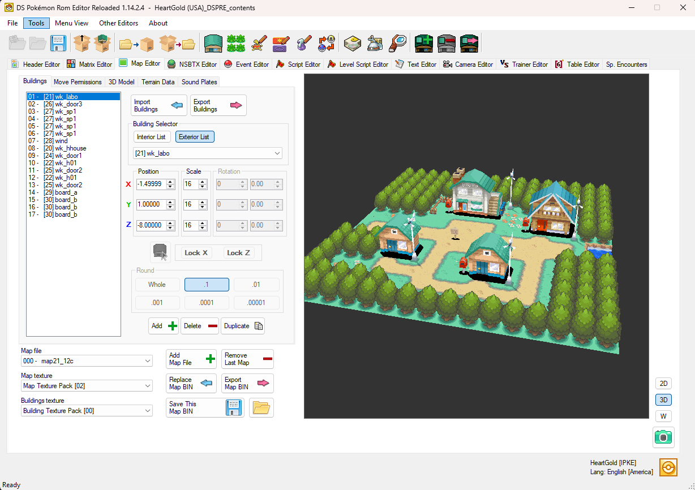
</p>

**DSPRE (DS Pokémon ROM Editor Reloaded)** is a tool for editing Nintendo DS Pokémon games (Generation IV). It allows you to modify maps, scripts, events, Pokémon data, trainers, and more.

For additional documentation, tutorials, and research on DS Pokémon ROM hacking, see the **[DS Pokémon Hacking Wiki](https://ds-pokemon-hacking.github.io/)**.

---

## Table of Contents

- [Supported Games](#supported-games)
- [Editors](#editors)
- [ROM Toolbox Patches](#rom-toolbox-patches)
- [Related Tools](#related-tools)
- [Installation](#installation)
- [Getting Started](#getting-started)
- [Enhancements Over Original DSPRE](#enhancements-over-original-dspre)
- [Development Guide](#development-guide)
- [Contributing](#contributing)
- [External Resources](#external-resources)

---

## Supported Games

| Game | EN | ES/IT/FR/DE | JP | KR | Notes |
|------|-----|----------------|-----|-----|-------|
| **Diamond** | Full Support | Extensive Support | Partial Support | Minimal Support | |
| **Pearl** | Full Support | Extensive Support | Partial Support | Minimal Support | |
| **Platinum** | Full Support | Extensive Support | Partial Support | Minimal Support | |
| **HeartGold** | Full Support | Extensive Support | Partial Support | Minimal Support | |
| **SoulSilver** | Full Support | Extensive Support | Partial Support | Minimal Support | |
| **hg-engine ROMs** | Partial Support | N/A | N/A | N/A | Some editors disabled |

---

## Editors

### Map Editor

View and edit 3D map-related data including collisions, permissions, building placement, import and export of map models.

- OpenGL 3D visualization
- Mouse-based building placement and movement
- Collision editing with type painters
- Permissions editing with flood fill
- BGS (Background Sound) section editing
- BDHCAM import/export
- Map NSBMD and BIN import/export
- DAE, GLB, and NSBMD model export
- 512px map screenshot export (for PDSMS backgrounds)


**Note:** To create new maps from scratch, use **[Pokémon DS Map Studio (PDSMS)](https://github.com/Trifindo/Pokemon-DS-Map-Studio)**.

---

### Script Editor

Edit game scripts in binary or plaintext format.

- Syntax highlighting via ScintillaNET
- Dual-format support (binary `.bin` and plaintext `.script`)
- External editing support with VS Code
- Script Navigator for quick navigation
- Search for any command
- Text Search and Replace
- Syntax error detection
- Level script clearing
- Number format selection (hex or decimal)
- Custom script command database support

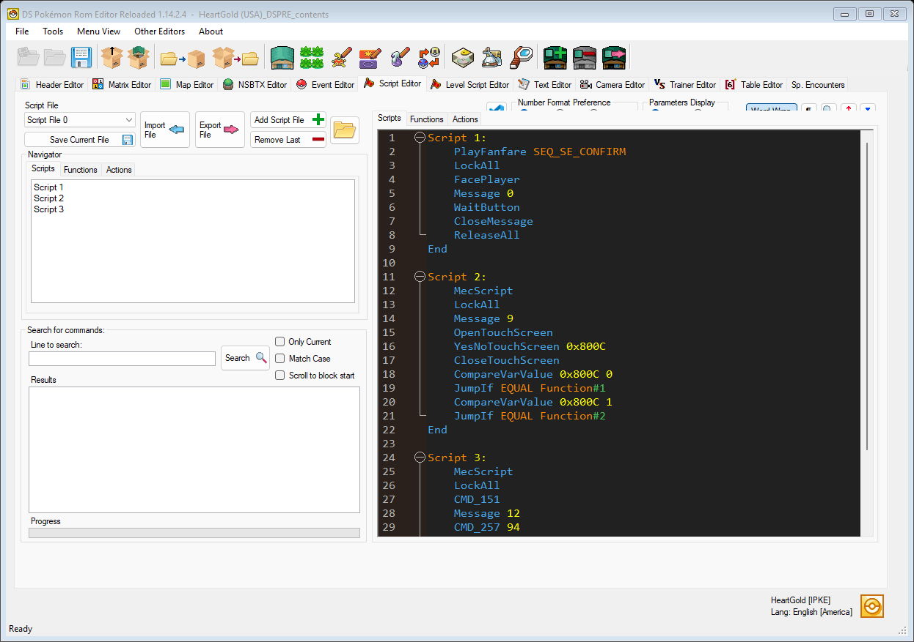

**VS Code Extension:** Install the **[DSPRE Script Compatibility extension](https://github.com/DS-Pokemon-Rom-Editor/vsc-dspre-script-compat)** for syntax highlighting when editing scripts externally. This can be installed directly in VS Code by searching "DSPRE" in the Extensions: Marketplace.

**Script Command Databases:** The command databases are maintained at **[scrcmd-database](https://github.com/DS-Pokemon-Rom-Editor/scrcmd-database)**. Contributions are welcome.

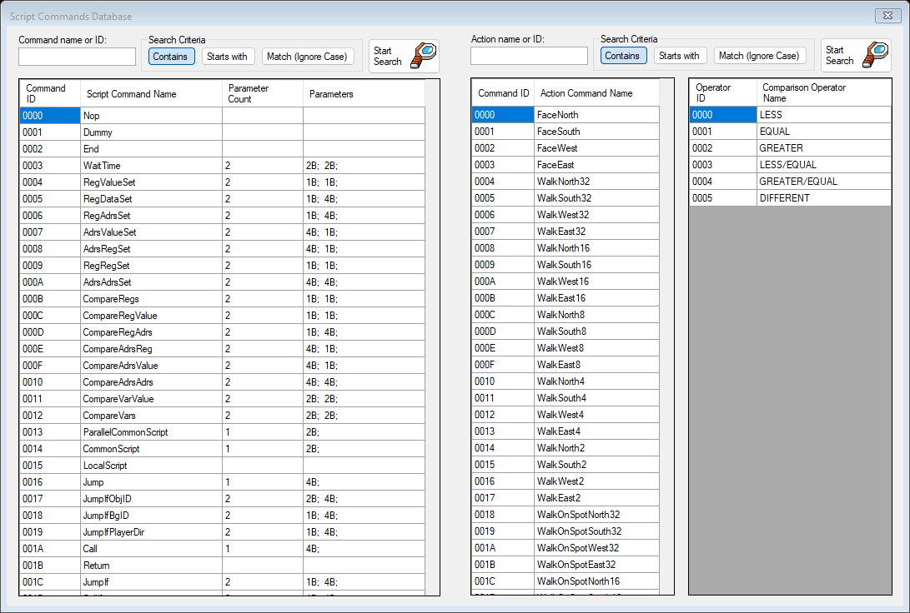

---

### Header Editor

Edit map header properties.

- Copy and paste headers
- Import and export
- Add and remove headers (if relevant patch applied)
- Location search
- WorldMap Coordinates (HGSS)
- Weather effects with preview
- Internal names editing
- Battle Background and Following Pokémon properties
- Camera settings
- Music settings

---

### Matrix Editor

Edit world map layout and connections.

- Custom color table support
- Matrix resizing
- Status bar coordinates
- Matrix names in selector

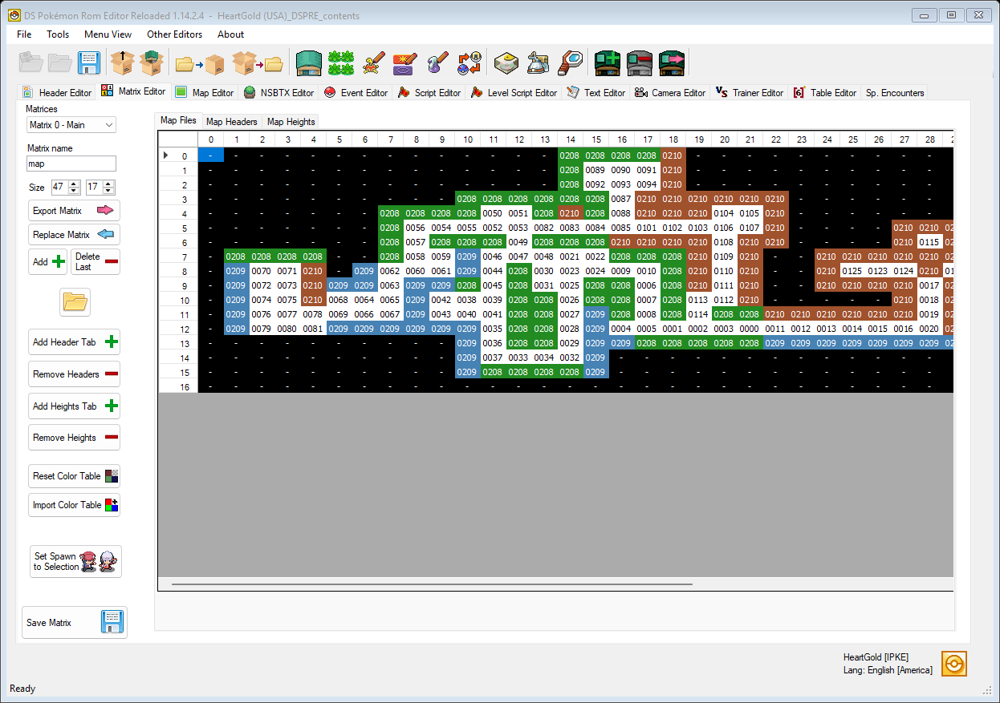

---

### Event Editor

Place and configure NPCs, warps, triggers, and spawnables.

- Mouse-based event placement
- Warp navigation
- Event duplication
- Selective event import from other files
- Overworld sprite rendering
- 512px customisable map and event data screenshot export

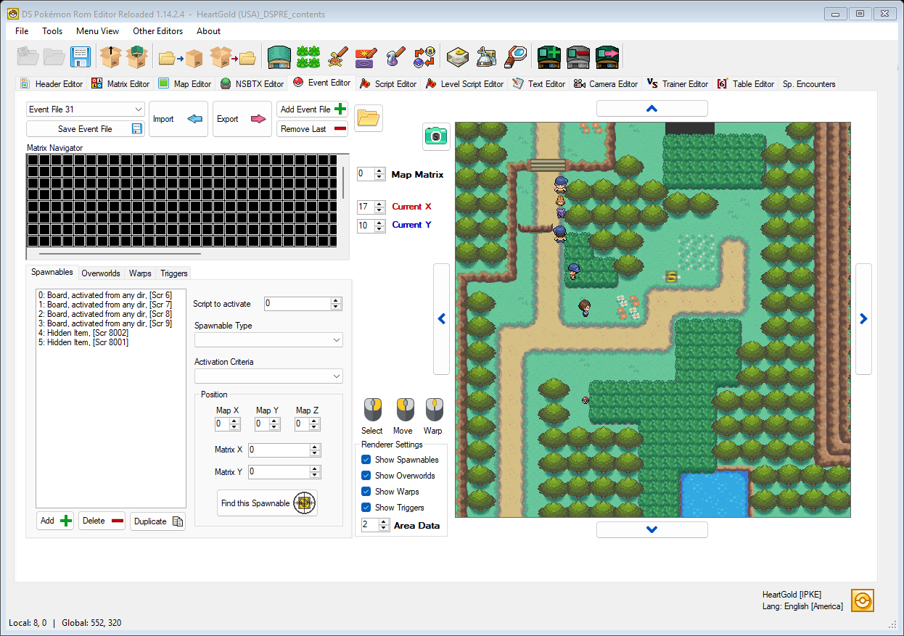

---

### Wild Encounters Editor

Configure wild Pokémon encounters.

- Encounter slot editing
- Import and export
- Add and remove encounter files
- Broken encounter file repair
- Separate editors for DPPt and HGSS formats

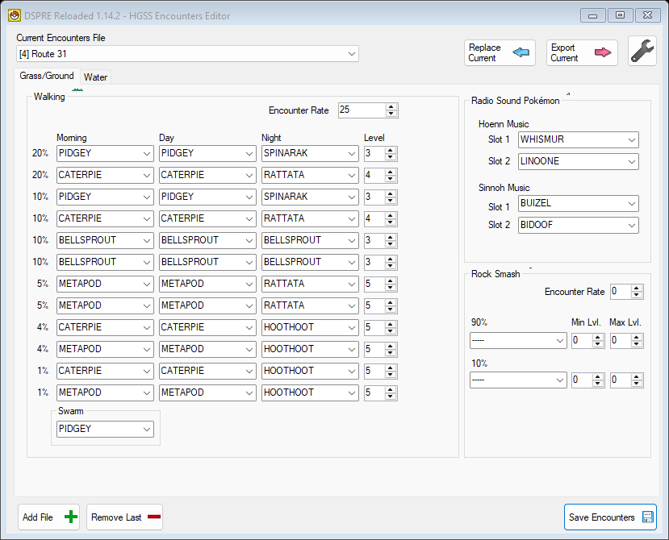

---

### Trainer Editor

Edit trainer data including party, AI, and items.

- Trainer Class editing
- Party composition (up to 6 Pokémon)
- Custom movesets
- AI flags
- Trainer and held items
- Party reordering
- DV Calculator (IV & Nature determination)
- Export to Showdown format

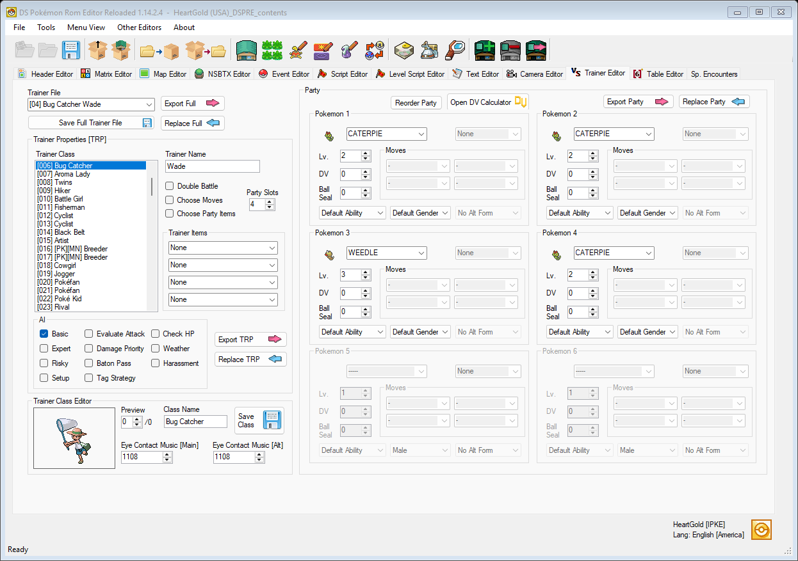

**Note:** For more advanced trainer editing features, see **[VSMaker2](https://github.com/Chvlkie/VSMaker2)**, which supports DSPRE unpacked ROMs.

**Note:** See [Generation IV Trainer Move Selection AI Reference](https://gist.github.com/lhearachel/ff61af1f58c84c96592b0b8184dba096) for details on AI flags.

---

### Pokémon Data Editors

#### Personal Data Editor
Edit Pokémon base stats and attributes.

- Base stats (HP, Attack, Defense, Sp.Atk, Sp.Def, Speed)
- Types
- Abilities
- EV yield
- TM/HM compatibility
- Catch rate, base EXP, growth rate
- Gender ratio
- Egg groups
- CSV import/export

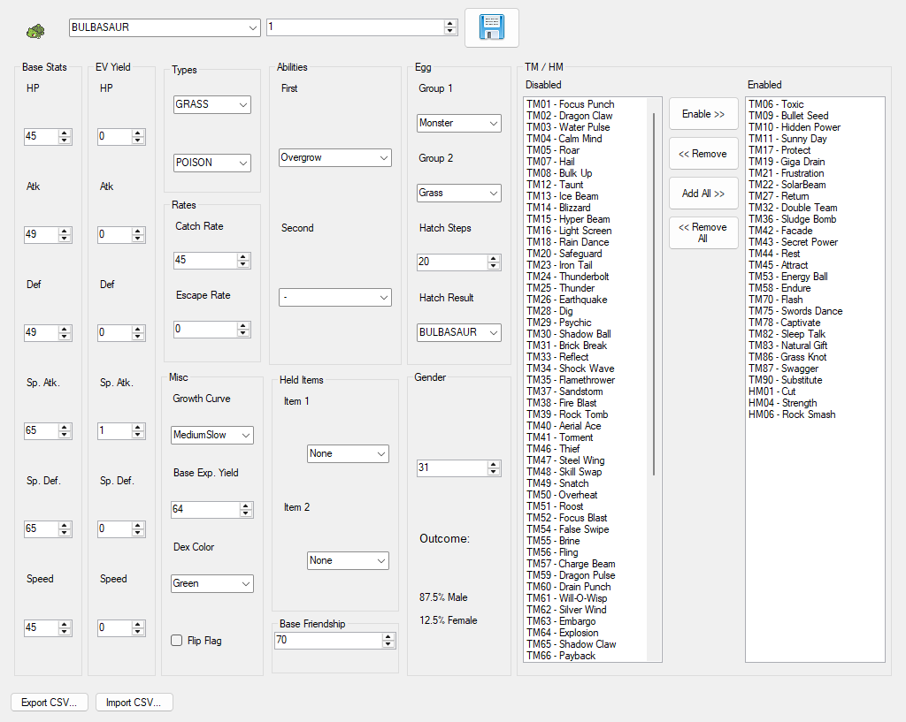

#### Learnset Editor
Edit level-up moves.

- Add, edit, and delete moves
- Auto-sorting by level
- Manual sorting of moves learned at the same level
- Entry count warning for 20+ moves (see [maximum move threshold](https://ds-pokemon-hacking.github.io/docs/generation-iv/guides/editing_moves/#maximum-move-threshold))
- Bulk Learnset Editor with:
  - CSV import/export
  - Copy learnset to other Pokémon
  - Global move replacement
  - Level adjustment
  - Filter and search

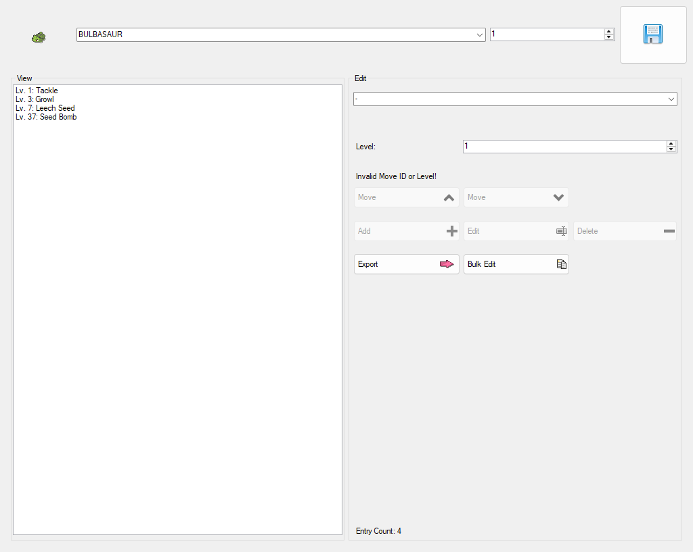

#### Evolution Editor
Edit evolution methods and targets.

- All evolution methods supported
- Evolution parameters (level, item, move, etc.)
- Multiple evolution paths

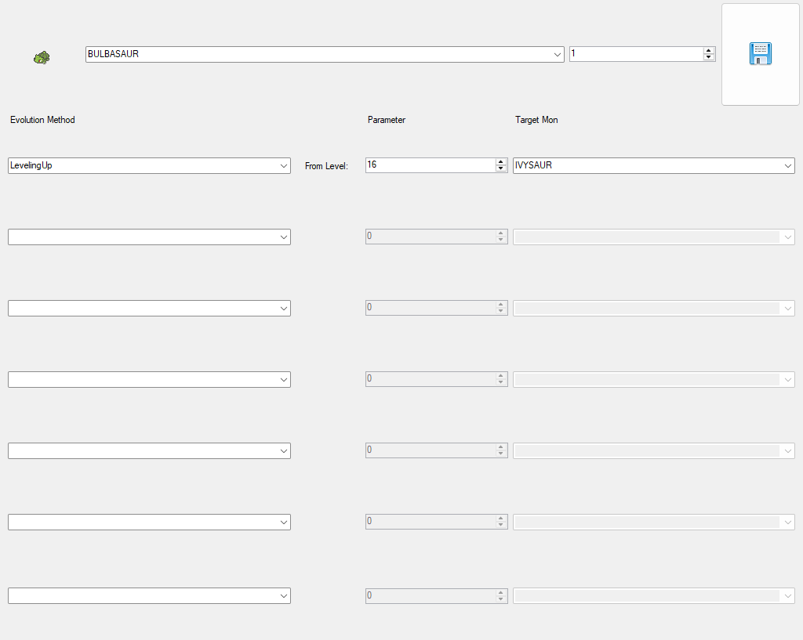

#### Egg Move Editor
Edit egg moves by species.

- Bulk replace and delete
- Search by Pokémon name
- CSV import/export
- Size limit tracking

---

### Move Data Editor

Edit move properties.

- Type, Split, Power, Accuracy, PP
- Priority
- Side Effect Probability
- Attack Range/Target
- Battle Effect Sequence
- Move Flags
- Contest data
- Natural Gift, Fling, Pluck effects
- CSV import/export

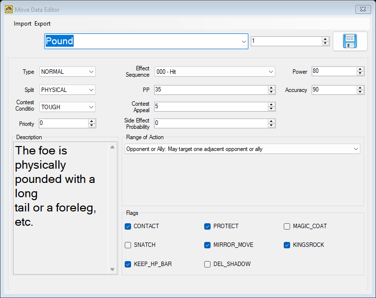

For more information, see the [DS Pokémon Hacking Wiki - Editing Moves](https://ds-pokemon-hacking.github.io/docs/generation-iv/guides/editing_moves/).

---

### Item Editor

Edit item data and effects.

- Icon and palette selection
- Price
- Hold effects
- Field and Battle pocket
- Field and Battle use functions
- Natural Gift, Fling, Pluck effects
- Party Use Parameters (status healing, HP/PP restoration, stat boosters, EV modifiers, friendship modifiers)

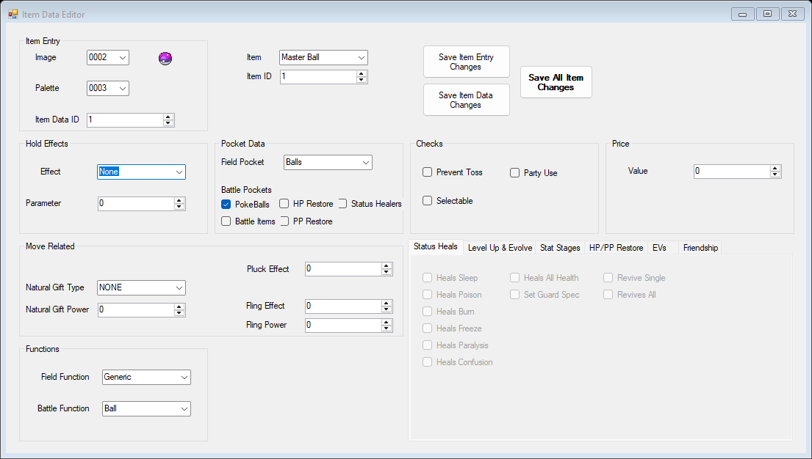

---

### TM Editor

Edit TM/HM move assignments and item palettes.

---

### Trade Editor

Edit in-game trade Pokémon.

- Species (given and requested)
- IVs
- Held item
- PID
- OT ID and gender
- Contest stats
- Origin language
- Nickname and OT name

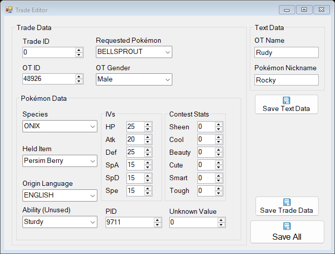

---

### Safari Zone Editor (HGSS)

Edit Safari Zone encounters.

- All zone areas
- Grass, Surf, and Rod encounters
- Block placement requirements
- Import/export

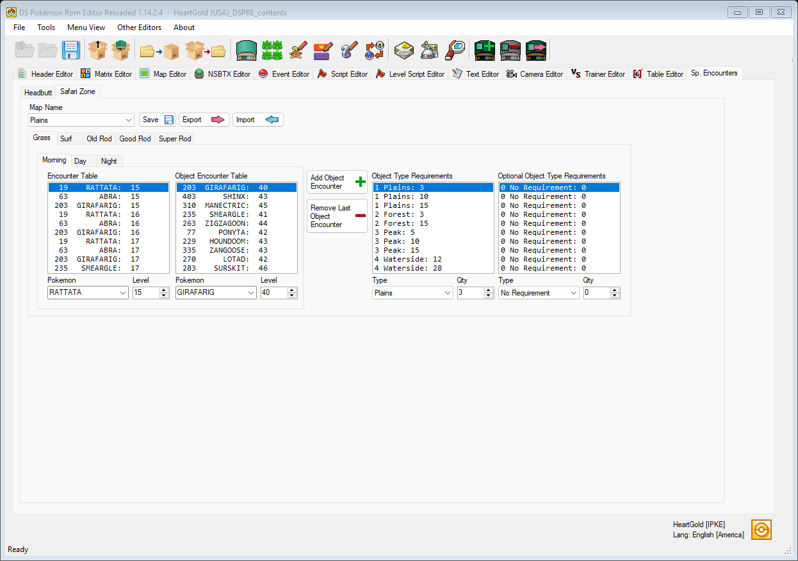

---

### Headbutt Encounter Editor (HGSS)

Edit Headbutt tree encounters with 3D map visualization.

- Normal and Special tree groups
- Click-to-select trees on map
- Import/export

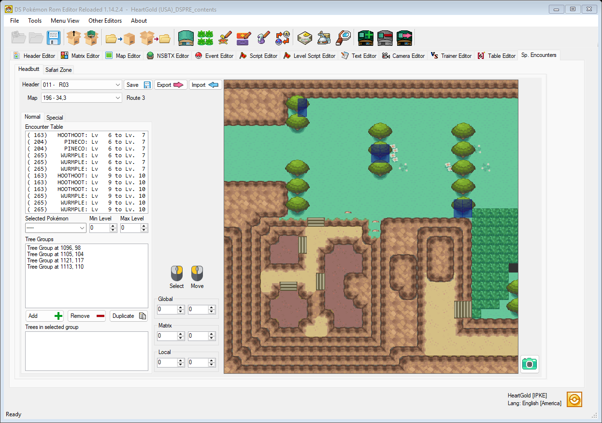

---

### Fly Editor

Edit fly destination tables.

- Game-over respawn locations
- Fly warp destinations
- Unlock conditions

---

### Camera Editor

Edit camera positions and angles.

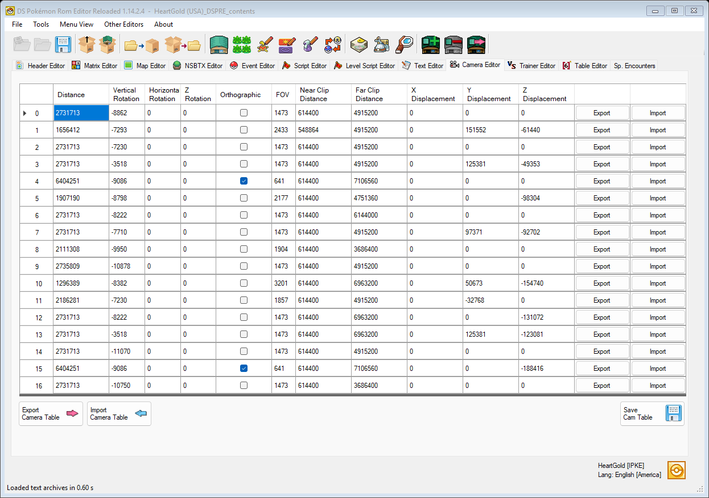

---

### Building Editor

View and manage 3D building models.

- Interior and exterior models
- NSBMD model viewing
- Building NSBMD import/export
- DAE building export

---

### NSBTX Editor

Add, edit and delete AreaData and texture packs.

- Add and remove map and building texture packs (NSBTX)
- Add, edit and remove AreaData files
- Import/export NSBTX and AreaData
- Palette matching
- Texture preview

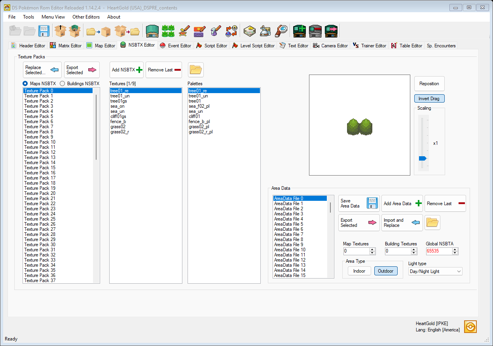

---

### Text Editor

Edit in-game text.

- Line reordering
- Row number display (decimal or hex)
- Search and Replace
- Chinese text support
- STRVAR helper with type reference
- Import/export

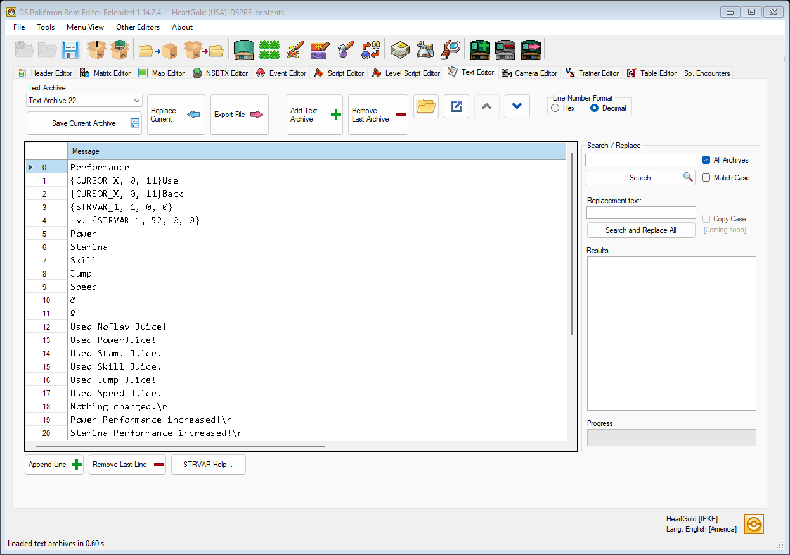

---

### Table Editor

Edit various game tables.

- Conditional Music Table (HGSS)
- Pre-Battle Effects (VS. sequences and battle tracks)

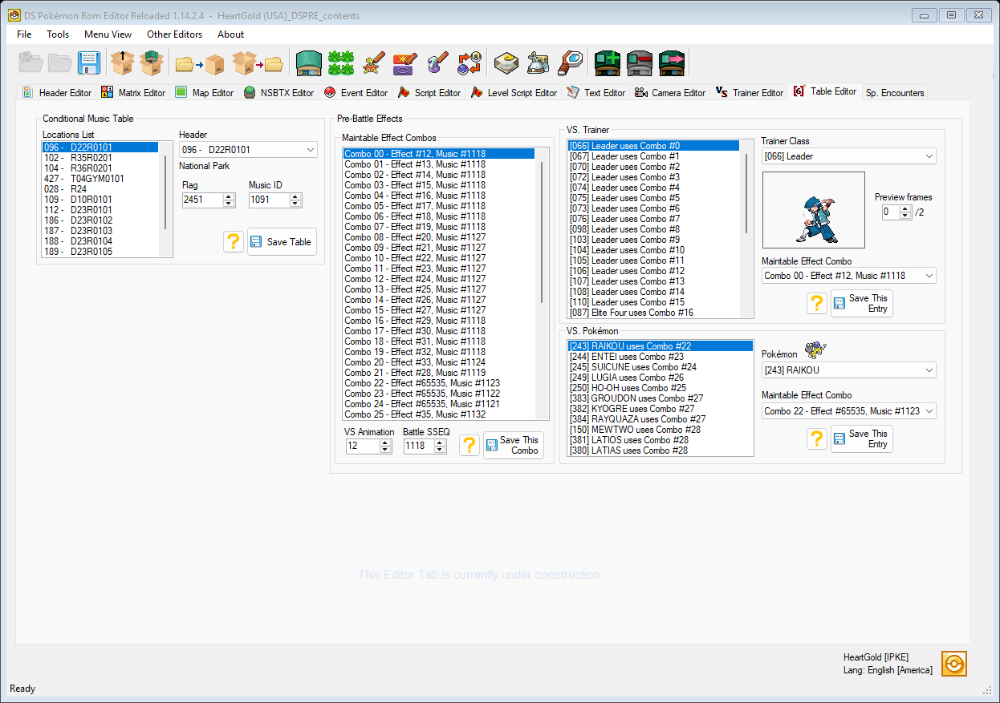

---

### Overlay Editor

View and manage overlays.

- Compression status
- Decompression operations
- RAM address mapping

---

### Spawn Settings Editor

Edit starting location and money.

---

### Utilities

- NARC Packer/Unpacker
- Batch Rename (list-based and content-based)
- Advanced Header Search
- NSBMD/NSBTX utilities
- DocTool (export data to CSV)

---

## ROM Toolbox Patches

Apply patches to expand ROM capabilities:

| Patch | Description |
|-------|-------------|
| Expand ARM9 Memory | Increase usable ARM9 memory |
| Dynamic Cameras | BDH camera positioning |
| Overlay1 Uncompressed | Keep Overlay1 uncompressed |
| Sentence Case Names | Convert Pokémon names to sentence case |
| Standardize Items | Standardize item numbers across games |
| Expand Matrix 0 | Larger world map matrices |
| Dynamic Headers | Extended header functionality |
| Disable Texture Animations | HGSS texture animation killswitch |
| Script Command Repointing | Custom script database support |
| Trainer Name Expansion | Extended trainer name length |

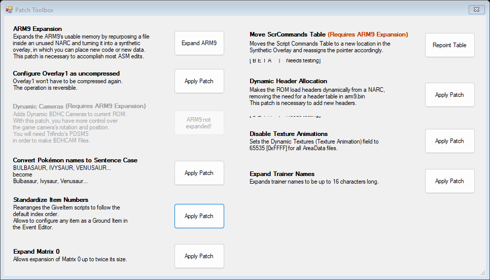

---

## Related Tools

| Tool | Purpose |
|------|---------|
| **[Pokémon DS Map Studio](https://github.com/Trifindo/Pokemon-DS-Map-Studio)** | Create new 3D maps from scratch |
| **[VSMaker2](https://github.com/Chvlkie/VSMaker2)** | Advanced trainer editor (supports DSPRE unpacked ROMs) |
| **[VS Code Extension](https://github.com/DS-Pokemon-Rom-Editor/vsc-dspre-script-compat)** | Syntax highlighting for DSPRE scripts |

---

## Installation

### Requirements
- Windows 7 or later
- .NET Framework 4.8

### Download
1. Download the latest release from [GitHub Releases](https://github.com/DS-Pokemon-Rom-Editor/DSPRE/releases)
2. Extract to a folder of your choice
3. Run `DSPRE.exe`

---

## Getting Started

1. Open DSPRE and click "Open ROM" or drag-drop a `.nds` file
2. Wait for ROM extraction (first-time setup)
3. Select an editor tab to begin editing
4. Save your work frequently in each editor
5. Click "Save ROM" to repack changes to a modified `.nds` file
6. Test your ROM in an emulator

---

## Enhancements Over Original DSPRE

These improvements were made compared to the original DSPRE by Nomura:

- Faster load and save times
- Fixed Japanese DP ROM support
- Configurable toolbar layouts
- User preference persistence
- Automatic updates via Velopack
- Auto-updating script command databases
- Application logging with crash reporter
- Load extracted data from directory without ROM
- ARM9 mismatch warnings
- ALT key shortcuts
- Custom character map support
- Recent project quick-open

---

## Development Guide

### Prerequisites
- .NET SDK 10 (9.0.300 or newer) and the .NET 8 runtime
- Git

### Building from Source
```powershell
git clone https://github.com/DS-Pokemon-Rom-Editor/DSPRE.git
cd DSPRE
dotnet build DSPRE.sln -c Release
```

### Solution Structure

```
DSPRE/
├── DSPRE.Core/       # ROM formats, data model, scripts and the rest of the non-UI logic
├── DSPRE.Avalonia/   # The app: views, view models and the 3D renderer
└── DSPRE.Tests/      # xUnit tests
```

How editors are built and the rules new code follows: [DSPRE-Development.md](DSPRE-Development.md).

---

## Contributing

### Pull Request Process

1. Fork the repository
2. Create a feature branch: `git checkout -b feature/my-feature`
3. Commit your changes with clear messages
4. Ensure the solution builds without errors
5. Create a Pull Request with a detailed description

---

## External Resources

### DS Pokémon Hacking Wiki
The **[DS Pokémon Hacking Wiki](https://ds-pokemon-hacking.github.io/)** is the primary documentation resource for DS Pokémon ROM hacking:

- **[Generation IV Guides](https://ds-pokemon-hacking.github.io/docs/category/guides)**
- **[Generation IV Resources](https://ds-pokemon-hacking.github.io/docs/category/resources)**
- **[Getting Started](https://ds-pokemon-hacking.github.io/docs/generation-iv/guides/getting_started/)**

### Repositories
- **[DSPRE](https://github.com/DS-Pokemon-Rom-Editor/DSPRE)** - This repository
- **[Script Command Database](https://github.com/DS-Pokemon-Rom-Editor/scrcmd-database)** - Script command definitions (contributions welcome)
- **[VS Code Extension](https://github.com/DS-Pokemon-Rom-Editor/vsc-dspre-script-compat)** - Syntax highlighting for external script editing

---

## License

This project is open source. See the repository for license details.

---

## Credits

- Original DSPRE by Nomura
- Pokéwalker picture format: DECODE_IMG and ENCODE_IMG by DmitryGR, with BluRose's PNG changes, from hg-engine
- All contributors to the DSPRE Reloaded project
- The DS Pokémon ROM hacking community
